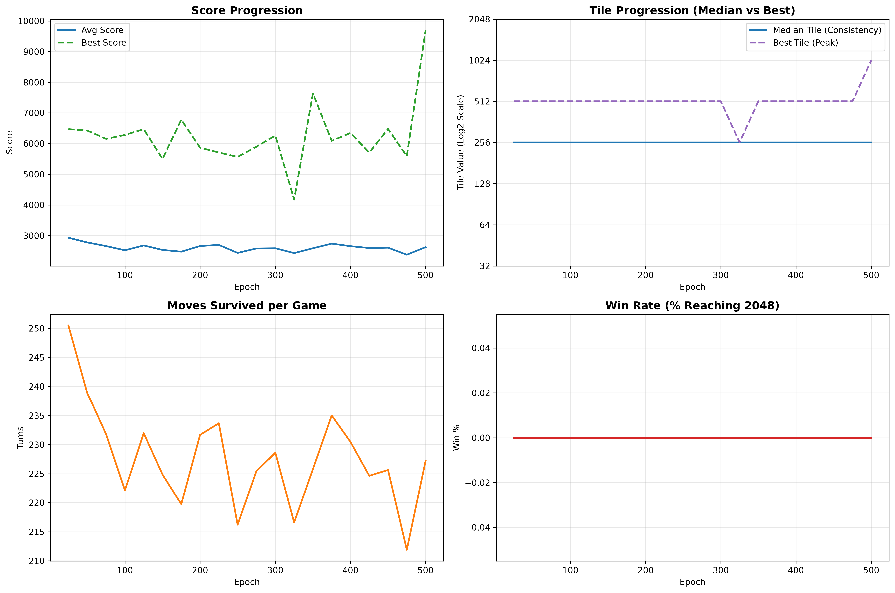
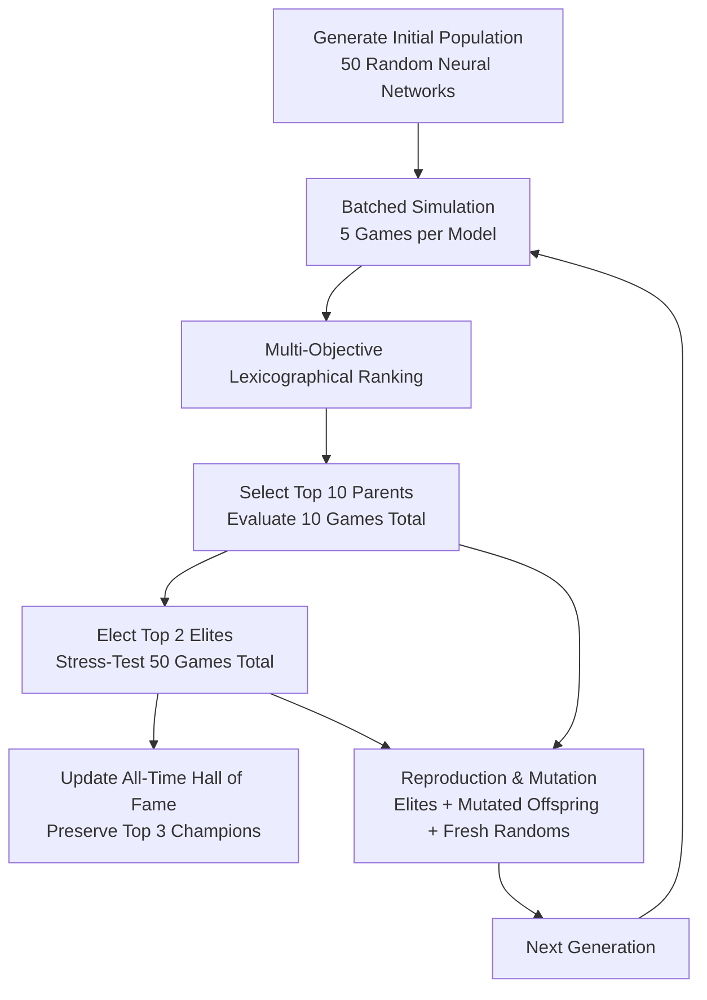

# 2048 AI: NeuroEvolution Agent

An autonomous AI agent for the game **2048** trained using **NeuroEvolution** (Genetic Algorithms) in PyTorch and NumPy. The agent learns optimal movement strategies purely through evolutionary selection, reproduction, and mutation without gradient descent or reinforcement learning backpropagation.



---

## 🚀 Key Highlights & Engineering Optimizations

To evaluate thousands of game simulations across generations quickly on CPU, the game engine and neural network evaluation pipeline are built with high-performance vectorization:

- **Vectorized Batched Game Simulation (`play_n_games_batched`)**:
  Simultaneously plays $N$ games in a 3D NumPy array (`(N, 4, 4)`). All active games run batched neural network forward passes, cutting forward-pass overhead by over **60%** compared to serial execution.
- **Precomputed Row Lookup Table (LUT)**:
  Board sliding and tile merges are accelerated using a 50,625-entry lookup table mapping any 4-tile row configuration directly to its merged result and score gain in microseconds.
- **Zero-Copy Flat 1D Tile Spawning**:
  Empty-tile selection uses `np.flatnonzero(board == 0)` with 1D index mapping, running over **3.5× faster** than conventional 2D coordinate search.
- **Multiprocessing Parallelism**:
  Bypasses Python's Global Interpreter Lock (GIL) using `ProcessPoolExecutor` with `torch.set_num_threads(1)` pinned per worker, scaling across all available CPU cores.
- **Intelligent Game Reuse**:
  Generation evaluations reuse completed games across parent evaluations and elite stress-tests, eliminating redundant simulations.

---

## 🧠 Model Architecture & NeuroEvolution Pipeline

### Policy Network Architecture
The current primary model (`initialize_model_5`) is a 4-layer fully connected policy network using `Tanh` activations:
```
Input (16 Normalized Board Tiles)
   │
   ▼
Linear(16 → 64)  +  Tanh
   │
   ▼
Linear(64 → 32)  +  Tanh
   │
   ▼
Linear(32 → 16)  +  Tanh
   │
   ▼
Linear(16 → 4)   →  Action Logits [Up, Down, Left, Right]
```
Moves are selected by ranking output logits in descending order and executing the highest-priority legal move.

---

### Evolutionary Loop



### Multi-Objective Ranking Strategy
Models are ranked hierarchically to prevent low-score flukes from overshadowing consistent agents:
1. **Win Rate**: % of games reaching the 2048 tile.
2. **Median Tile**: Robust measure of typical tile achievement ($256, 512, 1024, 2048$).
3. **Score Tier**: Average score rounded to 100-point buckets (allows secondary metrics to resolve close ties).
4. **Highest Tile**: Peak tile reached across all evaluated games.
5. **Average Moves**: Survival duration and merge progression.

---

## 📊 Training Progression (500 Epochs)

| Metric | Early Epochs (1–50) | Mid Epochs (150–300) | Peak Generations (400–480) |
|---|---|---|---|
| **Average Score** | ~3,200 – 3,600 | ~4,200 – 4,800 | **8,600+** (Top Champions) |
| **Median Tile** | 128 / 256 | 256 | **512** |
| **Highest Tile** | 512 | 512 / 1024 | **1024** |
| **Average Moves** | ~250 – 280 | ~300 – 340 | **380+** |

### 🏆 Hall of Fame Champions
The training run successfully produced high-performing champions capable of reaching **1024** with average scores exceeding **8,600**:
- **Champion #1 (Epoch 477)**: Median Tile: `512` | Highest Tile: `1024` | Avg Score: `8693.6`
- **Champion #2 (Epoch 426)**: Median Tile: `512` | Highest Tile: `1024` | Avg Score: `8680.0`
- **Champion #3 (Epoch 415)**: Median Tile: `512` | Highest Tile: `1024` | Avg Score: `8424.0`

---

## 🔬 In-Depth Analysis & Ongoing Improvements

### 1. The 256/512 Plateau
While models reliably reach 256 and frequently 512, reaching 2048 consistently requires strict board management (keeping the highest tile locked in a corner and maintaining a monotonic snake order). Without explicit incentives for corner discipline, high tiles occasionally drift into center positions, terminating runs prematurely.

### 2. Mutation Dynamics & Refinements
- **Dense vs. Sparse Mutation**: Mutating 100% of the network's 3,764 parameters simultaneously causes high perturbation drift ($\|\Delta W\| \approx 0.62$), which can disrupt delicate endgame skills.
- **Sparse Masking**: Upgrading to a Bernoulli mask (modifying only 10%–20% of weights per mutation) preserves learned behaviors.
- **Multi-Scale Mutation Tiers**:
  - *50% Fine-tuning* ($\sigma = 0.005$, 10% rate) for exploiting and refining champion play.
  - *35% Balanced evolution* ($\sigma = 0.02$, 15% rate).
  - *15% Exploratory jumps* ($\sigma = 0.05$, 25% rate) for escaping local plateaus.

### 3. Future Horizons
- **Afterstate Evaluation**: Evaluating candidate resulting boards $S'$ rather than guessing moves directly from current state $S$.
- **Heuristic Quality Metrics**: Incorporating corner retention ratio and average empty cells directly into selection.

---

## 🛠️ Getting Started

### Prerequisites
- Python 3.10+
- PyTorch
- NumPy
- Matplotlib
- Pandas

### Installation
```bash
git clone git@github.com:pratripat/2048-agent.git
cd 2048-agent
python -m venv .venv
source .venv/bin/activate
pip install torch numpy matplotlib pandas
```

### Running the Notebook
Launch Jupyter or VS Code and open `2048_NeuroEvolutionModel.ipynb`:
```bash
jupyter notebook 2048_NeuroEvolutionModel.ipynb
```
Execute the cells to initialize the fast lookup table, define the model architectures, and start training.
